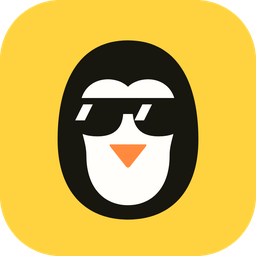

<p align="center">
  
</p>

<h1 align="center">MisterDescarga</h1>

<p align="center">
  Programa gratis para Windows que descarga video y audio de YouTube, TikTok, Instagram, X, Facebook, SoundCloud y más de 1000 sitios.
</p>

---

## Qué hace

- Pegas un enlace, ves la vista previa y eliges el formato: **MP4** (mejor calidad, 1080p, 720p o 480p), **MP3** (320 o 192 kbps) o **M4A**.
- Descarga **playlists completas**.
- Muestra el progreso en vivo con velocidad y tiempo restante, y permite varias descargas a la vez.
- Si copias un enlace, el programa lo **detecta** y te ofrece descargarlo.
- Guarda un historial con botones para abrir el archivo o la carpeta.
- Puede usar las cookies de tu navegador para videos que piden iniciar sesión.
- No necesita servidores ni cuentas, y no tiene publicidad. Todo pasa en tu PC.

Por dentro usa [yt-dlp](https://github.com/yt-dlp/yt-dlp), [FFmpeg](https://ffmpeg.org) y [Deno](https://deno.com). El programa los descarga solo la primera vez que lo abres (unos 250 MB).

## Cómo usarlo

1. Ve a **Releases** (a la derecha en esta página) y baja **`MisterDescarga-x.y.z-portable.zip`** (unos 12 MB).
2. Descomprímelo donde quieras: el escritorio, Documentos o un USB.
3. Abre la carpeta y haz doble clic en **`MisterDescarga.exe`**.
4. La primera vez baja sus herramientas (un par de minutos). Después, pega un enlace y listo.

No se instala nada en el computador. Las herramientas, los ajustes y el historial se guardan en la carpeta `datos` que está dentro. Puedes llevar la carpeta en un USB y usarla en otro PC con Windows 10 u 11.

Los videos se guardan en `Descargas\MisterDescarga`. Puedes cambiar la carpeta en **Ajustes**.

### "Windows protegió su PC"

Si sale ese aviso, pulsa **Más información** y luego **Ejecutar de todas formas**. `MisterDescarga.exe` es el Python oficial (firmado por la Python Software Foundation) con otro nombre, así que el Control inteligente de aplicaciones de Windows no lo bloquea.

### Si un sitio deja de funcionar

Los sitios cambian seguido. Ve a **Ajustes → Herramientas → Actualizar yt-dlp**.

## Compilar desde el código

Necesitas [Python 3.11 o superior](https://www.python.org/downloads/) y [Node.js 20 o superior](https://nodejs.org).

```bat
git clone <url-de-este-repo>
cd MisterDescarga
build.bat
```

Queda lista en `dist\MisterDescarga\` (para usarla ya) y comprimida en `dist\MisterDescarga-x.y.z-portable.zip` (para compartirla).

### Publicar una versión nueva

1. Cambia el número de versión en `app/version.py`.
2. Crea y sube un tag:
   ```bat
   git tag v1.0.1
   git push origin v1.0.1
   ```
3. GitHub Actions arma el `.zip` y lo publica en **Releases** automáticamente.

## Estructura

```
app/        Python: ventana (pywebview), descargas (yt-dlp), ajustes
datos/      (se crea al usarlo) herramientas, ajustes e historial
ui/         Interfaz: React + Vite + Tailwind
assets/     Icono y logo
scripts/    Armado de la versión portátil y generación del icono
```

## Aviso

Usa MisterDescarga solo con contenido que tengas derecho a descargar, y respeta los derechos de autor y los términos de cada sitio.

## Licencia

[MIT](LICENSE)
